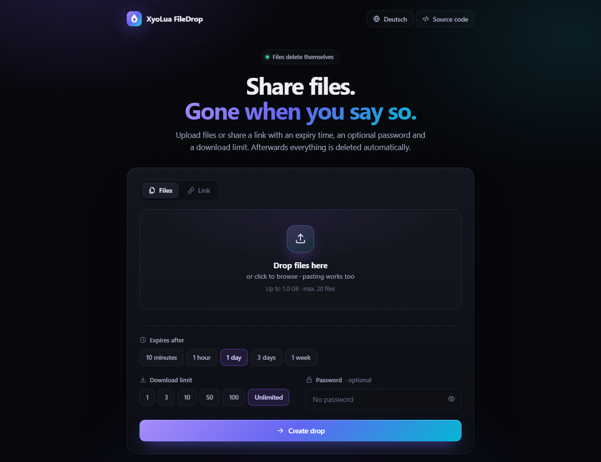

<div align="center">


# XyoLua FileDrop

**Selbst gehostetes, temporäres Teilen von Dateien & Links – weg, wann du willst.**

[English version](README.md)



</div>

## Funktionen

- **Dateien teilen** – per Drag & Drop, Einfügen oder Auswahl, mit Fortschritt, Geschwindigkeit und Restzeit
- **Links teilen** – Besucher sehen zuerst nur die Domain und entscheiden selbst, ob sie den Link öffnen
- **Ablaufzeit** – von 10 Minuten bis 7 Tage (einstellbar)
- **Passwortschutz** – mit scrypt gehasht, Rateversuche werden begrenzt
- **Download-Limits** – Einmal-Links oder beliebige Limits, serverseitig gezählt
- **Automatische Löschung** – nach Ablauf, beim Erreichen des Limits oder vorzeitig durch den Ersteller
- **Verwaltungslink** – Statistik ansehen und Drop vorzeitig löschen
- **Alle als ZIP**, **QR-Code**, **letzte Drops** (nur lokal im Browser gespeichert)
- **Moderne Dark-UI** auf Deutsch und Englisch, ohne externe Schriften, Tracker oder CDNs
- **Einfach zu hosten** – ein Node.js-Prozess, keine Datenbank, nur zwei kleine Abhängigkeiten, Docker inklusive

## Selbst hosten

### Mit Docker

```bash
git clone https://github.com/xyoluastudios/xyolua-filedrop.git
cd xyolua-filedrop
cp .env.example .env   # optional: Einstellungen anpassen
docker compose up -d
```

Danach läuft FileDrop auf <http://localhost:8080>.

### Mit Node.js (ab Version 22)

```bash
git clone https://github.com/xyoluastudios/xyolua-filedrop.git
cd xyolua-filedrop
npm ci --omit=dev
npm start
```

### Öffentlich betreiben

Hinter einen Reverse Proxy mit HTTPS (z. B. Caddy oder nginx, Beispiele im [englischen README](README.md#running-it-publicly)) stellen und `BASE_URL` sowie `TRUST_PROXY=1` setzen.

> [!IMPORTANT]
> Ein offenes Upload-Formular im Internet wird früher oder später für Spam oder Schadsoftware missbraucht.
> Setze für öffentliche Instanzen **`UPLOAD_PASSWORD`** (Herunterladen braucht es nie), lass `MAX_STORAGE` und die Rate-Limits aktiv
> und prüfe, welche rechtlichen Pflichten du als Betreiber hast (z. B. Impressum).

## Konfiguration

Alle Optionen sind Umgebungsvariablen und in [`.env.example`](.env.example) beschrieben. Die wichtigsten:

| Variable | Standard | Bedeutung |
| --- | --- | --- |
| `BASE_URL` | – | Öffentliche Adresse, z. B. `https://drop.example.com` |
| `MAX_UPLOAD_SIZE` | `1GB` | Maximale Größe eines Drops |
| `MAX_FILES` | `20` | Maximale Dateien pro Drop |
| `MAX_STORAGE` | `0` | Speicherplatz für alle Drops, `0` = unbegrenzt |
| `UPLOAD_PASSWORD` | – | Passwort, das zum Hochladen nötig ist |
| `MAX_EXPIRY` | `7d` | Längste erlaubte Ablaufzeit |
| `TRUST_PROXY` | `0` | Anzahl Reverse Proxies vor FileDrop |

## Datenschutz & Sicherheit

- Dateien liegen unverschlüsselt auf dem Server – wer die Instanz betreibt, kann sie lesen.
- Es werden keine IP-Adressen, Dateinamen oder andere personenbezogenen Daten geloggt.
- Downloads werden immer als Anhang ausgeliefert, strenge Content-Security-Policy, keine externen Ressourcen.

Details stehen im [englischen README](README.md#how-it-works) und in [SECURITY.md](SECURITY.md).

## Lizenz

[MIT](LICENSE) © XyoLua Studios
