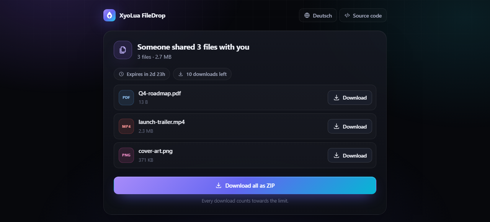

<div align="center">


# XyoLua FileDrop

**Self-hosted, temporary file & link sharing — gone when you say so.**

Upload files or share a link, pick an expiry time, an optional password and a download limit.
When the time is up or the last download is done, everything is deleted automatically.

[](LICENSE)


[Deutsche Version](README.de.md)


</div>

## Features

- **File drops** – drag & drop, paste or pick up to 20 files (configurable), with live progress, speed and ETA
- **Link drops** – share a URL; visitors only see the domain until they choose to open it
- **Expiry time** – from 10 minutes to 7 days (presets and maximum are configurable)
- **Password protection** – passwords are hashed with scrypt, wrong guesses are rate-limited
- **Download limits** – one-time links or any limit you like; every download is counted server-side
- **Automatic deletion** – files are removed when they expire, hit their limit or are deleted by the owner
- **Management link** – the uploader gets a private link to see download stats and delete the drop early
- **Download all as ZIP**, **QR code** for the share link, **recent drops** list (kept only in your browser)
- **Modern dark UI** in English and German, responsive, no external fonts, trackers or CDNs
- **Easy to self-host** – one Node.js process, files on disk, no database, two small dependencies, Docker image included

<p align="center"></p>

## Self-hosting

### Docker (recommended)

```bash
git clone https://github.com/xyoluastudios/xyolua-filedrop.git
cd xyolua-filedrop
cp .env.example .env   # optional: adjust the settings
docker compose up -d
```

FileDrop now runs on <http://localhost:8080>. Uploads are stored in the `filedrop-data` Docker volume.

Once a release has been published, you can also use the prebuilt image:

```bash
docker run -d --name filedrop -p 8080:8080 -v filedrop-data:/data ghcr.io/xyoluastudios/xyolua-filedrop:latest
```

### Node.js

Requires Node.js 22 or newer.

```bash
git clone https://github.com/xyoluastudios/xyolua-filedrop.git
cd xyolua-filedrop
npm ci --omit=dev
npm start
```

Configuration is read from environment variables (see below). Uploads go to `./data` unless `DATA_DIR` says otherwise.

### Running it publicly

Put FileDrop behind a reverse proxy that terminates HTTPS and set `BASE_URL` and `TRUST_PROXY=1`.

**Caddy**

```caddy
drop.example.com {
	reverse_proxy localhost:8080
}
```

**nginx**

```nginx
server {
    server_name drop.example.com;
    listen 443 ssl;
    # ssl_certificate ...

    client_max_body_size 1100m;      # a bit more than MAX_UPLOAD_SIZE
    proxy_request_buffering off;     # stream uploads straight through
    proxy_read_timeout 1h;
    proxy_send_timeout 1h;

    location / {
        proxy_pass http://127.0.0.1:8080;
        proxy_set_header Host $host;
        proxy_set_header X-Forwarded-For $proxy_add_x_forwarded_for;
        proxy_set_header X-Forwarded-Proto $scheme;
    }
}
```

> [!IMPORTANT]
> An open upload form on the internet will eventually be used to spread spam or malware.
> For public instances set **`UPLOAD_PASSWORD`** so only people you trust can upload (downloading never needs it),
> keep `MAX_STORAGE` and the rate limits in place, and check which legal obligations apply to you as an operator.

## Configuration

All settings are environment variables. Copy [`.env.example`](.env.example) to `.env` for Docker Compose.

| Variable | Default | Description |
| --- | --- | --- |
| `PORT` | `8080` | HTTP port |
| `HOST` | `0.0.0.0` | Interface to listen on |
| `BASE_URL` | – | Public URL, e.g. `https://drop.example.com`. Used for links returned by the API |
| `DATA_DIR` | `data` | Storage directory for uploads and metadata |
| `SITE_NAME` | `XyoLua FileDrop` | Name shown in the UI |
| `MAX_UPLOAD_SIZE` | `1GB` | Maximum size of one drop (all files together) |
| `MAX_FILES` | `20` | Maximum files per drop |
| `MAX_STORAGE` | `0` | Disk quota for all drops, `0` = unlimited |
| `UPLOAD_PASSWORD` | – | Require this password for uploads |
| `MAX_EXPIRY` | `7d` | Longest allowed lifetime |
| `EXPIRY_PRESETS` | `10m,1h,1d,3d,7d` | Expiry options in the UI |
| `DEFAULT_EXPIRY` | `1d` | Preselected expiry |
| `MAX_DOWNLOADS` | `1000` | Highest selectable download limit |
| `ALLOW_UNLIMITED_DOWNLOADS` | `true` | Allow drops without a download limit |
| `ALLOW_LINKS` | `true` | Allow link drops |
| `ALLOW_ZIP` | `true` | Offer "download all as ZIP" |
| `SECRET` | auto | Signs unlock cookies. Generated and saved to `DATA_DIR/.secret` if empty |
| `TRUST_PROXY` | `0` | Number of reverse proxies in front of FileDrop |
| `RATE_LIMIT_UPLOADS` | `30` | Uploads per IP and hour, `0` = off |
| `RATE_LIMIT_UNLOCK` | `10` | Wrong passwords per IP in 15 minutes before blocking |
| `CLEANUP_INTERVAL` | `1m` | How often expired drops are purged |

Sizes accept `B`, `KB`, `MB`, `GB`, `TB`; durations accept `s`, `m`, `h`, `d`, `w`.

## API

Everything the UI does is available over a small JSON API, so FileDrop works great with `curl` and scripts.

```bash
# upload two files, valid for 1 hour, 5 downloads, password protected
curl -F expiresIn=3600 -F maxDownloads=5 -F password=s3cret \
     -F files=@report.pdf -F files=@photo.jpg \
     https://drop.example.com/api/drops
```

```json
{
  "id": "Xk3pQ9vLm2aZ",
  "url": "https://drop.example.com/d/Xk3pQ9vLm2aZ",
  "manageUrl": "https://drop.example.com/d/Xk3pQ9vLm2aZ#owner=…",
  "ownerKey": "…",
  "expiresAt": 1767225600000,
  "maxDownloads": 5
}
```

| Method & path | Description |
| --- | --- |
| `GET /api/config` | Limits and options of this instance |
| `POST /api/drops` | Create a drop (`multipart/form-data`): `files` (repeatable), `type` (`files`/`link`), `url`, `expiresIn` (seconds), `maxDownloads` (`0` = unlimited), `password`. Send `X-Upload-Key` if the instance requires it |
| `GET /api/drops/:id` | Drop details. `401 locked` if password protected and not unlocked |
| `POST /api/drops/:id/unlock` | JSON `{"password": "…"}` → sets an HttpOnly access cookie for 1 hour |
| `GET /api/drops/:id/files/:index` | Download one file (counts as one download) |
| `GET /api/drops/:id/zip` | Download all files as ZIP (counts as one download) |
| `POST /api/drops/:id/open` | Resolve a link drop (counts as one open) |
| `DELETE /api/drops/:id` | Delete early. Requires header `X-Owner-Key` |
| `POST /api/upload-key` | Check an upload password (`204` or `401`) |
| `GET /healthz` | Health check |

Downloading a password-protected drop with curl:

```bash
curl -c cookies.txt -H 'Content-Type: application/json' -d '{"password":"s3cret"}' https://drop.example.com/api/drops/<id>/unlock
curl -b cookies.txt -OJ https://drop.example.com/api/drops/<id>/files/0
```

## How it works

- Each drop lives in `DATA_DIR/drops/<id>/`: a `meta.json` plus the uploaded files under neutral names (`file-0`, `file-1`, …). Original file names are only kept inside `meta.json` and are never used as paths.
- Uploads are streamed straight to disk while size, count and quota limits are enforced. A rejected or aborted upload leaves nothing behind.
- Drop IDs are 12 random base62 characters (~71 bits), management keys are 256-bit random tokens stored only as SHA-256 hashes.
- Downloads are always sent as `application/octet-stream` attachments, so uploaded HTML or SVG can never run in the context of your instance. A strict Content-Security-Policy, `Referrer-Policy: no-referrer` and other security headers are set on every response.
- The download counter is increased *before* a download starts, so parallel requests cannot exceed the limit. A drop that reached its limit is deleted as soon as the last running download has finished.
- FileDrop does not log IP addresses, file names or any other personal data. Rate limits are kept in memory only.
- Metadata is held in memory and persisted to disk, so run **one** process per data directory.

> [!NOTE]
> Files are stored unencrypted on the server. Whoever runs the instance can read them, so use an instance you trust,
> or encrypt sensitive files before uploading. End-to-end encryption is a welcome contribution (see below).

## Development

```bash
npm install
npm run dev     # restarts on changes, http://localhost:8080
npm test        # API + unit tests (node:test, no extra tooling)
```

```
src/
  server.js     entry point, HTTP server, cleanup timer
  app.js        routes, uploads, downloads, access control
  store.js      file-system storage and lifecycle of drops
  security.js   scrypt, signed cookies, rate limiting, headers
  zip.js        streaming ZIP writer
  config.js     environment configuration
public/
  index.html    upload page          assets/upload.js
  drop.html     download page        assets/drop.js
  assets/       styles, shared helpers, translations (i18n.js)
```

### Adding a language

Copy the `en` block in [`public/assets/i18n.js`](public/assets/i18n.js), translate it and add it under its language code. The UI picks it up automatically based on the browser language.

## Contributing

Issues and pull requests are welcome! Ideas: end-to-end encryption, S3-compatible storage, resumable uploads, an admin dashboard, more languages. See [CONTRIBUTING.md](CONTRIBUTING.md) and [SECURITY.md](SECURITY.md).

## License

[MIT](LICENSE) © XyoLua Studios
